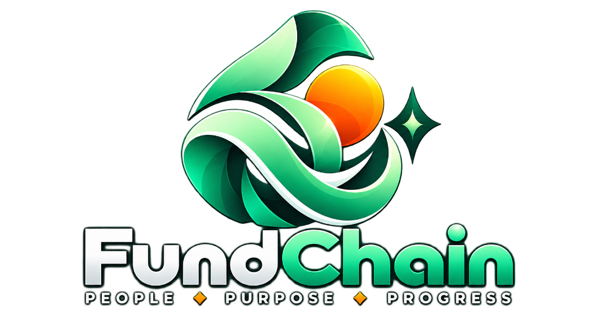
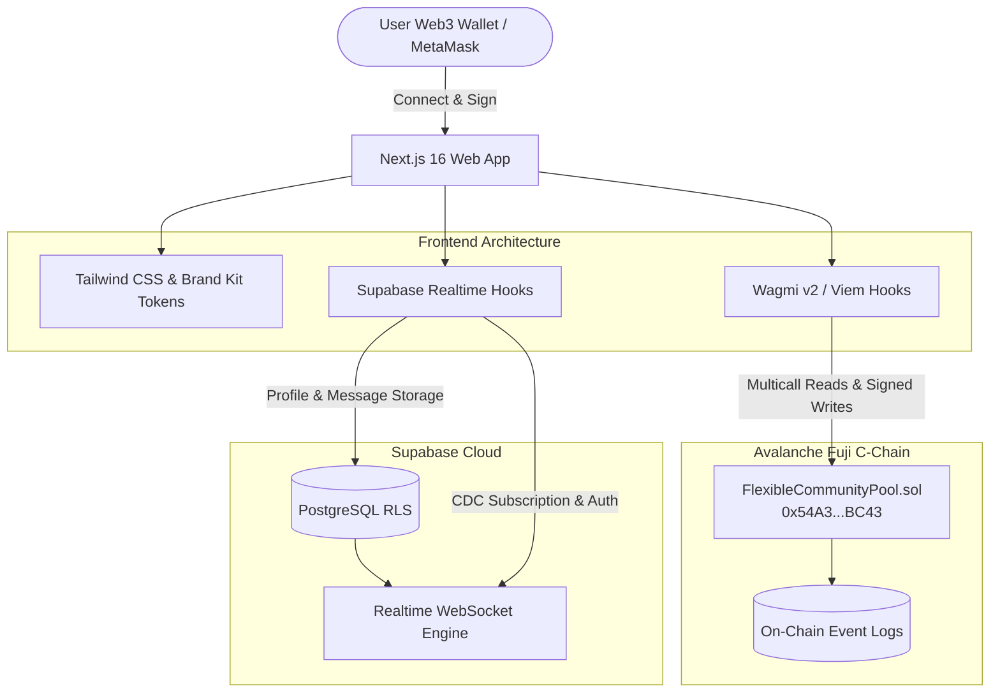

<div align="center">



# FundChain

### People · Purpose · Progress

**A decentralized funding ecosystem that empowers people, supports real-world ideas, and builds stronger communities through transparent, on-chain funding.**

[](https://github.com/ElonCoding/FundChain/actions)
[](https://nextjs.org/)
[](https://testnet.snowtrace.io/address/0x54A39697E45a7dC7d6DC7e43B3cDAF8Cd71cBC43)
[](https://supabase.com/)
[](https://soliditylang.org/)
[](https://www.typescriptlang.org/)
[](https://wagmi.sh/)

[Key Features](#-key-features) • [System Architecture](#-system-architecture) • [Smart Contracts](#-smart-contracts) • [Brand Kit](#-brand-kit--design-system) • [CI/CD Pipeline](#-cicd-pipeline) • [Quick Start](#-quick-start)

---

</div>

## 🌟 Vision & Mission

> **"Fund People. Build Communities. Create Progress."**

Traditional group pooling and crowdfunding suffer from lack of transparency, hidden fees, and custodial risk. **FundChain** transforms group financing into an immutable, transparent, and collaborative experience on the **Avalanche C-Chain**. 

Whether collecting for a community initiative, a shared project, or running a provably fair raffle, all funds and transactions are governed by verified smart contracts with an integrated on-chain audit trail and encrypted Web3 communication.

---

## ✨ Key Features

### 1. 🏊 On-Chain Community Vaults & Pools
- **Event Payout Pools**: Transparent pooling where members contribute fixed or flexible AVAX amounts. Creator executes transfers directly to a designated recipient wallet with full on-chain provenance.
- **Lucky Draw Pools**: Automated pool where participants enter with fixed or flexible contributions. A random winner is picked transparently on Avalanche Fuji to receive 100% of the prize pot.
- **Multicall Synchronization**: Dynamic, batch-queried pool counts and parameters queried directly from the contract via Wagmi `useReadContracts`.

### 2. 💬 Encrypted Real-Time Web3 Chat
- **1-on-1 & Group Discussion**: Real-time communication powered by Supabase Realtime WebSocket engine with zero polling.
- **Direct Messaging Modal**: Initiate private conversations with any registered community member or by inputting their Avalanche wallet address directly.
- **On-Chain Transaction Previews**: Embedded SnowTrace transaction badges and block explorer links inside message threads.

### 3. 📜 On-Chain Audit Trail & Admin Panel (v2)
- **Dual-View Ledger**:
  - **On-Chain Pools**: View all created pools, creator addresses, target amounts, total collected, statuses, and block verification badges.
  - **Contributions Ledger**: Chronological transaction history tracking contributor wallets, exact AVAX amounts, and immutable timestamps.
- **Search & Filter**: Real-time filtering across wallet addresses, titles, and unique pool IDs.

### 4. 👥 People & Contact Network
- **Member Directory**: Explore online and registered members with live presence indicators.
- **Instant Member Add**: Upsert contacts directly by name and Avalanche C-Chain address.
- **Direct AVAX Transfer**: Peer-to-peer AVAX transfers executed directly from the member detail panel via connected Web3 wallet.

---

## 🏗️ System Architecture



---

## 📜 Smart Contracts

### Deployed Addresses (Avalanche Fuji)

| Contract | Network | Address | SnowTrace Link |
|---|---|---|---|
| **FlexibleCommunityPool (v2)** | Fuji Testnet (43113) | `0x54A39697E45a7dC7d6DC7e43B3cDAF8Cd71cBC43` | [View on SnowTrace](https://testnet.snowtrace.io/address/0x54A39697E45a7dC7d6DC7e43B3cDAF8Cd71cBC43) |
| **FundPool (Legacy v1)** | Fuji Testnet (43113) | `0xf838734D3655776AF116B3f41256EaEbFb8cD864` | [View on SnowTrace](https://testnet.snowtrace.io/address/0xf838734D3655776AF116B3f41256EaEbFb8cD864) |

### Core Contract Capabilities
- `createEventPool(title, desc, groupId, fixedAmt, minAmt, maxAmt, recipient, deadline)`
- `createLuckyDrawPool(title, desc, groupId, fixedAmt, minAmt, maxAmt, deadline)`
- `contribute(poolId)` (payable)
- `executePayout(poolId)` (Event pool payout to recipient)
- `pickWinner(poolId)` (Lucky draw winner selection)
- `getPool(poolId)` & `getPoolCount()` (Multicall read endpoints)
- `getContributions(offset, limit)` (Ledger pagination)

---

## 🎨 Brand Kit & Design System

The FundChain visual identity balances trust, vitality, and high-performance Web3 aesthetics.

| Color Name | Hex Code | Role |
|---|---|---|
| **Deep Forest** | `#0A2E22` | Primary container, dark depth, brand headers |
| **Emerald** | `#16A34A` | Primary brand accent, action buttons, verification badges |
| **Mint** | `#6EE7B7` | Glow accents, active highlights, gradient transitions |
| **Orange** | `#F97316` | Energy highlights, pending warnings, alert badges |
| **Charcoal** | `#0F172A` | Background foundation |
| **Slate** | `#334155` | Card borders and subtle separators |
| **Off White** | `#F8FAF7` | Headings and crisp readability |
| **Sand** | `#FEF3C7` | Warm accents and subtle tints |

- **Typography**: `Inter` (Clean, modern, legible across dense financial tables and chat bubbles).
- **Symbol Mark**: Flowing emerald/mint ribbon loop surrounding an orange sun sphere with a 4-point sparkle star.

---

## 🚀 CI/CD Pipeline

FundChain enforces automated quality gates and builds on every pull request and push to `main` via GitHub Actions (`.github/workflows/ci-cd.yml`):

1. **Lint & Type Safety**:
   - Executes `tsc --noEmit` across all TypeScript source files.
2. **Production Build Verification**:
   - Executes `next build` with Turbopack optimization.
   - Archives compiled production artifacts.
3. **Smart Contract ABI & Chain Verification**:
   - Validates contract deployment address maps and interface consistency.

---

## ⚡ Quick Start

### Prerequisites
- [Node.js](https://nodejs.org/) v18 or v20+
- [Git](https://git-scm.com/)
- MetaMask or any Web3 Wallet with Avalanche Fuji Testnet AVAX (from [Avalanche Faucet](https://core.app/tools/testnet-faucet/))

### 1. Clone & Install
```bash
git clone https://github.com/ElonCoding/FundChain.git
cd FundChain
npm install
```

### 2. Configure Environment Variables
Create a `.env.local` file in the root directory:
```env
NEXT_PUBLIC_SUPABASE_URL=https://<your-project-id>.supabase.co
NEXT_PUBLIC_SUPABASE_ANON_KEY=<your-supabase-anon-key>
NEXT_PUBLIC_WALLETCONNECT_PROJECT_ID=<your-walletconnect-project-id>
NEXT_PUBLIC_FLEXIBLE_POOL_ADDRESS=<your-deployed-contract-address>
```

### 3. Run Locally
```bash
npm run dev
```
Open [http://localhost:3000](http://localhost:3000) to view the application.

### 4. Run Verification Checks
```bash
# Verify TypeScript typings
npm run type-check

# Run Production Build
npm run build
```

---

## 🛡️ Security & Auditing

- **Checks-Effects-Interactions Pattern**: Guaranteed inside `FlexibleCommunityPool.sol` to prevent reentrancy exploits.
- **Supabase Row-Level Security (RLS)**: Enforced across `profiles`, `conversations`, and `messages` tables.
- **Non-Custodial Architecture**: Contract funds are held strictly within on-chain pool state, unlocked only upon explicit payout execution or winner draw.

---

## 📄 License

This project is licensed under the [MIT License](LICENSE).

<div align="center">
  <sub>Built with ❤️ for the Avalanche Web3 Ecosystem • FundChain 2026</sub>
</div>
